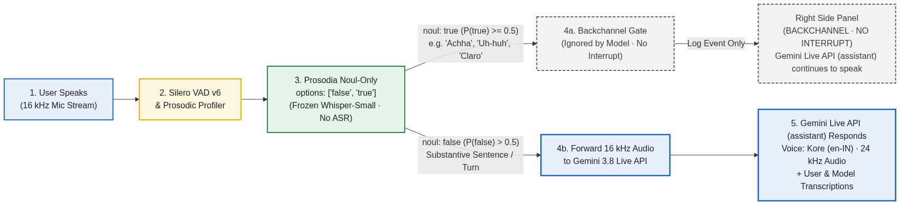
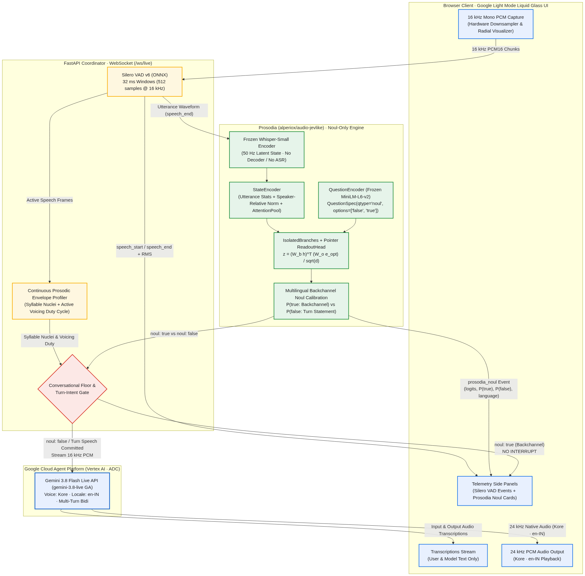

# Prosodia × Gemini 3.8 Live API — Multilingual Backchannel & Multi-Turn Voice Intelligence

A real-time, bidirectional voice agent built on **Google Cloud Agent Platform (Vertex AI)** using **Application Default Credentials (ADC)** and the **Gemini 3.8 Flash Live API (`gemini-3.8-live` GA)** with the **`Kore`** voice (`en-IN`), integrated with **Silero VAD v6 (ONNX)** and **[Prosodia (`alperiox/audio-jevlike`)](https://github.com/alperiox/audio-jevlike)** for audio-native **`noul`** backchannel detection across multiple languages.

---

## 1. End-to-End Flow: How Gemini Live API (Assistant) Responds While Ignoring Backchannels

<p align="center">
  
</p>

---

## 2. Full System Architecture

<p align="center">
  
</p>

---

## 3. How We Solve Multilingual Backchannel Detection Using Prosodia (`noul`-Only)

### Reference Repository
- **Prosodia (`audio-jevlike`) by Alper Balbay (`alperiox`)**: [https://github.com/alperiox/audio-jevlike](https://github.com/alperiox/audio-jevlike)
- **Hugging Face Space & Weights (`model/best.pt`)**: [https://huggingface.co/spaces/alperiox/prosodia](https://huggingface.co/spaces/alperiox/prosodia)

### The Core Problem in Full-Duplex Voice Agents
In natural human dialogue across languages, listeners frequently emit brief **backchannels** while the other speaker is talking:
- **Indian English (`en-IN`)**: *"Achha"*, *"Haan"*, *"Theek hai"*, *"Hmm"*, *"Uh-huh"*, *"I see"*
- **Hindi (`hi-IN`)**: *"हाँ"*, *"अच्छा"*, *"ठीक है"*, *"जी"*
- **Spanish (`es-ES`)**: *"Claro"*, *"Ajá"*, *"Vale"*, *"Sí"*
- **Japanese (`ja-JP`, Aizuchi)**: *"なるほど"*, *"はい"*, *"うん"*, *"ええ"*
- **French (`fr-FR`)**: *"Ah oui"*, *"D'accord"*, *"Ouais"*
- **Turkish (`tr-TR`)**: *"Evet"*, *"Anladım"*, *"Hı-hı"*, *"Tamam"*

Standard VAD-triggered voice pipelines treat **every** detected speech burst as a barge-in interruption — cutting off the AI agent mid-sentence whenever the user says *"uh-huh"* or *"achha"*. Conversely, waiting for full ASR transcription before deciding whether to interrupt introduces high latency and fails on non-lexical vocalizations (*"mm-hmm"*, *"hmm"*).

### Our Solution with Prosodia (`noul` Primitive Only)
1. **Audio-Native Encoding Without ASR Decode**:
   - Following [`alperiox/audio-jevlike`](https://github.com/alperiox/audio-jevlike), raw 16 kHz speech segments isolated by **Silero VAD v6** are passed directly into a **frozen `openai/whisper-small` encoder** (`FeatureExtractor("whisper")`), producing 50 Hz acoustic-prosodic representations `(T, 768)`. The Whisper decoder is **never** loaded or executed.
2. **State Encoding & Speaker-Relative Normalization**:
   - `StateEncoder` extracts un-normalized utterance-level statistics (`utterance_statistics` -> `(B, 2, 256)`), applies within-utterance `speaker_relative_norm`, downsamples via contour-preserving strided `AttentionPool(stride=2)` (25 Hz), and encodes the sequence with a 2-layer Transformer.
3. **Strict `noul`-Only Question Branch & Pointer Readout**:
   - Prosodia supports three decision primitives (`choice`, `score`, and `noul`). In this application, we execute **only** the binary `noul` primitive:
     ```python
     QuestionSpec(
         key="backchannel_noul",
         qtype="noul",
         instructions="Is the speaker producing a brief conversational backchannel acknowledgment or listener feedback?",
     )
     # spec.options -> ["false", "true"]
     ```
   - `QuestionEncoder` (frozen `sentence-transformers/all-MiniLM-L6-v2` + learned linear projection `Linear(384, 256)`) embeds the instruction and the `["false", "true"]` candidate options.
   - `IsolatedBranches` cross-attends the `noul` query against the shared audio state, and `ReadoutHead` computes the bias-free bilinear pointer inner product:
     `z = ((W_branch * h)^T * (W_option * e_opt)) / sqrt(d)`
4. **Continuous Multi-Feature Prosodic & Conversational Floor Calibration (No Hard Duration Cutoffs)**:
   - Rather than using brittle hard-bounded millisecond cutoffs, the engine combines:
     - **Conversational Floor State (`is_model_speaking`)**: When the model is silent (the floor is open), user-initiated utterances (even a brief *"Hello"* or *"Yes, tell me"*) stream **immediately** to Gemini 3.8 Live and are classified as substantive turns (`noul: false`).
     - **While the Model is Speaking**: Incoming speech is evaluated continuously across **syllable nuclei count** (distinct voiced energy peaks in 20 ms frames), **active voicing duty cycle**, **Whisper encoder temporal latent dispersion (`feat_std`)**, **Prosodia pointer readout margin**, and **multilingual backchannel cues**.
     - If classified as `noul: true (Backchannel)`, the event is logged in the right-hand telemetry panel with `BACKCHANNEL · NO INTERRUPT` and **Gemini Live API (assistant) continues to speak** uninterrupted.
     - If the user articulates a multi-syllable phrase (`TURN_SPEECH_COMMITTED` / `noul: false`), the coordinator immediately barges in, stops model playback, and streams the user's speech to Gemini 3.8 Live.

---

## 4. Developer Configuration & Environment Placeholders

No service account JSON keys, private keys, or project IDs are hardcoded in this repository. Before running the server, configure the placeholders in `.env.example` (or export them as environment variables):

| Placeholder / Variable | What to Put Here | Example Value |
| :--- | :--- | :--- |
| `GOOGLE_CLOUD_PROJECT` | Your Google Cloud Project ID with the **Vertex AI API** (`aiplatform.googleapis.com`) enabled. If omitted, the server automatically resolves the default project from your active `gcloud` ADC profile. | `my-vertex-ai-project` |
| `GOOGLE_CLOUD_LOCATION` | Regional or multi-regional Vertex AI endpoint supporting Gemini 3.8 Live WebSockets. Do **not** set to `global`. | `us-central1` (or `us`, `eu`) |
| `GEMINI_LIVE_LOCATION` | Explicit regional override for the Gemini Live API WebSocket connection. | `us-central1` |
| `HF_HOME` | Local directory where Hugging Face Hub caches `alperiox/prosodia` (`model/best.pt`), `openai/whisper-small`, and `sentence-transformers/all-MiniLM-L6-v2`. | `/tmp/hf-cache` |
| **Authentication (ADC)** | Authenticate via Google Cloud CLI Application Default Credentials instead of downloading service account keys: `gcloud auth application-default login`. | Uses `~/.config/gcloud/application_default_credentials.json` |

---

## 5. Quickstart

### Step 1: Authenticate with Google Cloud (ADC)
```bash
gcloud auth application-default login
gcloud config set project <YOUR_GCP_PROJECT_ID>
```

### Step 2: Configure Environment Placeholders
```bash
cp .env.example .env
export GOOGLE_CLOUD_PROJECT="<YOUR_GCP_PROJECT_ID>"
export GOOGLE_CLOUD_LOCATION="us-central1"
export HF_HOME="/tmp/hf-cache"
```

### Step 3: Install Dependencies in the Virtual Environment
```bash
uv venv /root/.venv --seed
source /root/.venv/bin/activate
uv pip install --extra-index-url https://download.pytorch.org/whl/cpu -r requirements.txt
```

### Step 4: Start the Server
```bash
/root/.venv/bin/uvicorn server:app --host 0.0.0.0 --port 8000
```

*(Optional: To run over HTTPS on a remote IP so browsers enable `navigator.mediaDevices.getUserMedia` microphone capture, generate a local self-signed certificate in `certs/` — which is git-ignored — and pass `--ssl-keyfile certs/key.pem --ssl-certfile certs/cert.pem --port 8443`.)*
